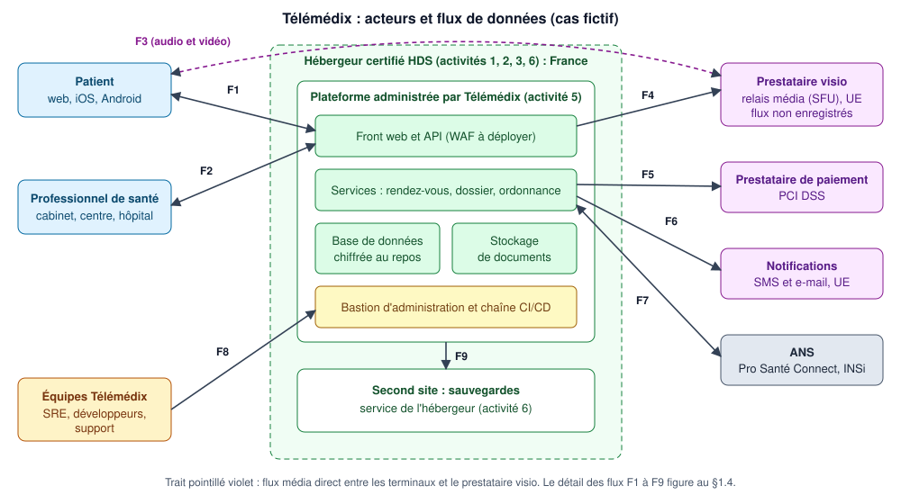

# 1. Cadrage du cas d'étude

> **Cas fictif.** Télémédix SAS, ses clients, son hébergeur et ses sous-traitants n'existent pas. Toute ressemblance avec une société réelle est fortuite. Les chiffres sont des hypothèses de travail.

## 1.1 Fiche d'identité

| Élément | Valeur (hypothèse) |
|---|---|
| Éditeur | **Télémédix SAS**, Paris, créée en 2019 |
| Produit | **Télémédix** : plateforme SaaS de téléconsultation (web + applications iOS/Android) |
| Modèle | B2B2C : l'éditeur vend la plateforme à des professionnels et structures de santé ; les patients sont les utilisateurs finaux |
| Effectif | 52 salariés (ETP) |
| Chiffre d'affaires / total bilan | 6,8 M€ / 5,1 M€ |
| Clients | 1 900 professionnels de santé libéraux, 40 centres de santé, 1 centre hospitalier |
| Volumétrie | 150 000 patients inscrits, 2 000 comptes professionnels, 30 000 téléconsultations par mois |
| Fonctions | Prise de rendez-vous, salle d'attente virtuelle, visio/audio, messagerie instantanée de consultation, dépôt de documents, compte rendu, ordonnance, paiement de l'acte |
| Statut | Éditeur de logiciel. Télémédix **ne salarie pas de médecins** : ce n'est pas une « société de téléconsultation » au sens du code de la santé publique |
| Dispositif médical | Non : aucune fonction d'aide au diagnostic ou à la décision thérapeutique |

### Organisation interne

| Équipe | Effectif | Rôle vis-à-vis de la sécurité |
|---|---|---|
| Direction (DG, CTO, DAF) | 3 | Approuve la PSSI, accepte les risques résiduels |
| Produit et développement | 22 | Développement sécurisé, revue de code |
| Exploitation (SRE) | 5 | Administration des VM, bases, sauvegardes, supervision |
| Support client | 8 | Assistance aux professionnels et aux patients |
| Commercial et marketing | 8 | Aucun accès à la production |
| Administration, RH, finance | 4 | Aucun accès à la production |
| RSSI | 1 (50 % sécurité, 50 % SRE) | Pilote la sécurité ; rattaché au CTO (écart : voir §1.7) |
| Qualité et conformité | 1 | Relais du DPO, gestion documentaire |
| DPO | Externe (cabinet) | Conseil et contrôle RGPD |

## 1.2 Périmètre de l'étude

| Dans le périmètre | Hors périmètre (justification) |
|---|---|
| Plateforme Télémédix en production (front, API, bases, stockage, sauvegardes) | Bureautique générale, paie, CRM commercial (pas de données de santé ; couverts par le socle d'hygiène) |
| Processus de développement et de déploiement (dépôt de code, CI/CD) | Systèmes d'information des clients (logiciel de cabinet, SIH) : responsabilité des clients |
| Processus d'exploitation et d'administration | Terminaux des patients : non maîtrisables, traités comme partie prenante |
| Processus de support client (accès aux comptes) | Alimentation du DMP / Mon espace santé : évolution prévue, non déployée |
| Relations avec l'hébergeur et les trois sous-traitants | Sécurité physique des centres de données : portée par l'hébergeur certifié |

## 1.3 Acteurs et rôles

| Acteur | Rôle opérationnel | Qualification RGPD | Qualification HDS |
|---|---|---|---|
| Professionnels et structures de santé (clients) | Réalisent les téléconsultations, tiennent le dossier | **Responsables de traitement** de la prise en charge | Clients de l'hébergement (ils confient des données de santé à un tiers) |
| **Télémédix SAS** | Édite, administre et exploite la plateforme | **Sous-traitant** des clients pour la téléconsultation et le dossier ; **responsable de traitement** pour le compte utilisateur patient, la relation client, le support et la sécurité | Réalise l'**activité 5** (administration et exploitation). Non certifiée à ce jour : **écart majeur**, voir dossier 5 |
| Hébergeur « HexaSanté Cloud » (fictif) | Fournit centres de données, serveurs, virtualisation, service de sauvegarde ; deux sites en France | Sous-traitant ultérieur | Certifié HDS, activités 1, 2, 3 et 6 |
| Prestataire visio « VisioLink EU » (fictif) | Serveurs de relais média (SFU) mutualisés, hébergés dans l'UE | Sous-traitant ultérieur. Il traite des données de santé : sans chiffrement de bout en bout, le flux est déchiffré sur ses serveurs | Flux en transit, non conservés : qualification à vérifier (voir annexe) |
| Prestataire de paiement « PayNord » (fictif) | Encaissement par carte, certifié PCI DSS niveau 1 | Sous-traitant ultérieur (ou responsable distinct pour ses obligations propres de lutte contre la fraude) | Sans objet : aucune donnée de santé |
| Prestataire de notifications « NotifExpress » (fictif) | Envoi de SMS et d'e-mails transactionnels, UE | Sous-traitant ultérieur | Sans objet **si** les messages ne contiennent aucune donnée de santé |
| ANS | Pro Santé Connect, téléservice INSi | Tiers (services socles nationaux) | Sans objet |
| Patients | Utilisateurs finaux | Personnes concernées | Sans objet |
| DPO externe | Conseil, contrôle | Sans objet | Sans objet |

## 1.4 Architecture et flux de données

| Flux | De → vers | Contenu | Donnée de santé ? | Protection actuelle |
|---|---|---|---|---|
| F1 | Patient ↔ plateforme | Identité, rendez-vous, documents déposés, messages | Oui | TLS 1.2+ ; mot de passe seul |
| F2 | Professionnel ↔ plateforme | Comptes rendus, ordonnances, agenda | Oui | TLS 1.2+ ; mot de passe, OTP SMS facultatif |
| F3 | Patient/professionnel ↔ prestataire visio | Flux audio et vidéo temps réel, non enregistrés | Oui | DTLS-SRTP de saut en saut ; pas de chiffrement de bout en bout |
| F4 | Plateforme → prestataire visio | Création de salle, jetons d'accès, identifiants techniques | Non (pseudonymes) | API authentifiée, TLS |
| F5 | Plateforme → prestataire de paiement | Montant, identifiant de transaction ; la carte est saisie sur la page du prestataire | Non | Redirection hébergée (périmètre PCI DSS réduit) |
| F6 | Plateforme → prestataire de notifications | Numéro ou e-mail, texte du message | Aujourd'hui **oui** (nom et spécialité du praticien dans le message) | TLS ; écart de minimisation |
| F7 | Plateforme ↔ ANS | Authentification du professionnel, vérification d'identité INS | Identifiant national de santé | Cible : Pro Santé Connect et INSi ; non déployé |
| F8 | Équipes Télémédix → plateforme | Administration, support, déploiements | Accès possible | VPN, bastion SSH, MFA partiel |
| F9 | Plateforme → sauvegardes (second site de l'hébergeur) | Copies complètes des bases et documents | Oui | Chiffrement au repos ; même compte d'administration que la production |

## 1.5 Données traitées et classification

Échelle de classification : **C1** public, **C2** interne, **C3** confidentiel, **C4** secret (données de santé, secrets techniques).
Besoins de sécurité notés de 1 (faible) à 4 (vital) : Disponibilité, Intégrité, Confidentialité, Traçabilité.

| Réf. | Donnée | Personnes | Classe | D | I | C | T | Remarque |
|---|---|---|---|---|---|---|---|---|
| D1 | Identité et coordonnées du patient | Patients | C3 | 2 | 3 | 3 | 3 | |
| D2 | Identifiant national de santé (matricule INS, fondé sur le NIR) | Patients | C4 | 2 | 4 | 4 | 4 | Usage encadré par le référentiel INS |
| D3 | Données médicales : motif, compte rendu, ordonnance, documents, messages | Patients | C4 | 3 | 4 | 4 | 4 | Cœur du secret médical |
| D4 | Flux audio et vidéo | Patients, professionnels | C4 | 4 | 2 | 4 | 2 | Non enregistré (minimisation) |
| D5 | Données de rendez-vous : date, praticien, spécialité | Patients | C4 | 3 | 3 | 4 | 3 | La spécialité révèle indirectement l'état de santé |
| D6 | Identité professionnelle (RPPS, spécialité) | Professionnels | C2 | 2 | 4 | 2 | 3 | Intégrité critique : usurpation |
| D7 | Données de paiement : jeton, montant, statut | Patients | C3 | 2 | 3 | 3 | 3 | Numéro de carte jamais stocké |
| D8 | Journaux et traces d'accès | Tous utilisateurs, salariés | C3 | 2 | 4 | 3 | 4 | Valeur probante |
| D9 | Secrets techniques : clés, mots de passe, jetons CI/CD | Sans objet | C4 | 3 | 4 | 4 | 4 | |
| D10 | Code source et configuration | Sans objet | C3 | 2 | 4 | 3 | 3 | |

## 1.6 Cadre réglementaire et normatif retenu

| Texte ou référentiel | S'applique à Télémédix ? | Traité dans |
|---|---|---|
| RGPD et loi Informatique et Libertés | Oui, comme sous-traitant et comme responsable de traitement | Dossier 3 |
| Code de la santé publique, art. L.1111-8 (hébergement de données de santé) | Oui : l'hébergeur doit être certifié ; l'éditeur aussi s'il réalise une activité d'hébergement | Dossier 5 |
| Référentiel de certification HDS v2 (ANS) | Oui pour l'activité 5 (analyse en dossier 5) | Dossier 5 |
| ISO/IEC 27001:2022 | Volontaire, mais prérequis de la certification HDS | Dossier 4 |
| PGSSI-S et référentiels ANS (INS, Pro Santé Connect) | Oui, opposables aux services numériques en santé | Dossiers 2 et 4 (socle) |
| Référentiel d'interopérabilité, de sécurité et d'éthique des SI de téléconsultation (ANS) | Oui pour l'éditeur d'un SI de téléconsultation ; calendrier d'opposabilité aux éditeurs à vérifier | Mentionné, hors périmètre détaillé |
| Directive NIS2 (UE) 2022/2555 | **Non transposée en France au 11/11/2026** ; applicabilité analysée | Dossier 5 |
| PCI DSS | Indirectement : encaissement délégué à un prestataire certifié | Dossier 2 (partie prenante) |
| Règlement (UE) 2017/745 (dispositifs médicaux) | Non : pas de finalité médicale propre au logiciel | Sans objet |

## 1.7 État initial de la sécurité (point de départ fictif)

Ce socle sert de base aux ateliers EBIOS RM. Il décrit une scale-up réaliste : des bonnes pratiques techniques, peu de formalisation.

| Domaine | Existant | Écart principal |
|---|---|---|
| Gouvernance | Charte informatique ; RSSI à mi-temps rattaché au CTO ; DPO externe | Pas de PSSI, pas de SMSI, pas de comité sécurité ; RSSI juge et partie |
| Conformité RGPD | Registre partiel ; contrats de sous-traitance signés avec les trois prestataires | Pas d'AIPD ; durées de conservation non appliquées techniquement |
| Authentification | MFA TOTP sur le bastion ; mot de passe + OTP SMS facultatif pour les professionnels ; mot de passe seul pour les patients | MFA absent sur la console de l'hébergeur et sur la CI/CD ; Pro Santé Connect non déployé |
| Chiffrement | TLS 1.2+ ; chiffrement des disques et des bases au repos | Pas de chiffrement applicatif des documents ; visio sans chiffrement de bout en bout |
| Sauvegardes | Quotidiennes, sur le second site de l'hébergeur | Même compte que la production, non immuables ; restauration jamais testée formellement |
| Journalisation | Journaux applicatifs conservés 3 mois | Accès aux dossiers tracés partiellement ; ni centralisation ni alerte |
| Développement | Revue de code par un pair ; test d'intrusion annuel (le dernier date de 14 mois) | Pas d'analyse automatique du code ni des dépendances ; données de production copiées en recette |
| Exploitation | Correctifs mensuels ; antivirus et chiffrement sur les postes, gérés par MDM | Pas d'EDR ; pas de délai de correction formalisé ; réseau de production peu cloisonné |
| Support | Fonction « se connecter en tant que » pour dépanner un utilisateur | Pas de justification, pas de limite de durée, pas de revue |
| Continuité | Second site passif chez l'hébergeur | PRA jamais testé ; RTO et RPO non définis |
| Sensibilisation | Session à l'arrivée | Aucun suivi ni exercice |

## 1.8 Hypothèses structurantes et justification des choix

| # | Choix | Pourquoi (argument d'entretien) |
|---|---|---|
| H1 | L'éditeur administre lui-même ses VM | Cas le plus fréquent chez les éditeurs SaaS santé et le plus instructif : il fait apparaître la question de l'activité 5 HDS, que l'on oublie quand on se contente de dire « notre hébergeur est certifié » |
| H2 | 52 salariés, 6,8 M€ de chiffre d'affaires | Juste au-dessus du seuil de 50 personnes : la qualification NIS2 dépend alors du secteur et non plus de la taille, ce qui oblige à argumenter |
| H3 | Visio sous-traitée, sans chiffrement de bout en bout | Réaliste (architecture SFU) et discriminant : « chiffré » ne veut pas dire « illisible par le prestataire » |
| H4 | Pas d'enregistrement des consultations | Minimisation ; réduit fortement la gravité d'une compromission du prestataire visio |
| H5 | Télémédix responsable de traitement du compte patient | Le compte est unique et sert auprès de plusieurs praticiens : l'éditeur en fixe finalités et moyens. Qualification à valider avec le DPO (voir annexe) |
| H6 | Encaissement par redirection vers le prestataire | Aucune donnée de carte ne transite par la plateforme : le périmètre PCI DSS est réduit au minimum |
| H7 | Aucun transfert hors UE pour les données de santé | Cohérent avec les exigences de localisation du référentiel HDS v2 ; les notifications push (Apple, Google) ne portent aucun contenu |
| H8 | Télémédix n'emploie pas de médecins | Évite le régime d'agrément des sociétés de téléconsultation, qui est un sujet distinct de la conformité cyber |
| H9 | État initial imparfait | Un dossier sans écart ne démontre rien : la valeur est dans le lien risque → mesure → action |
